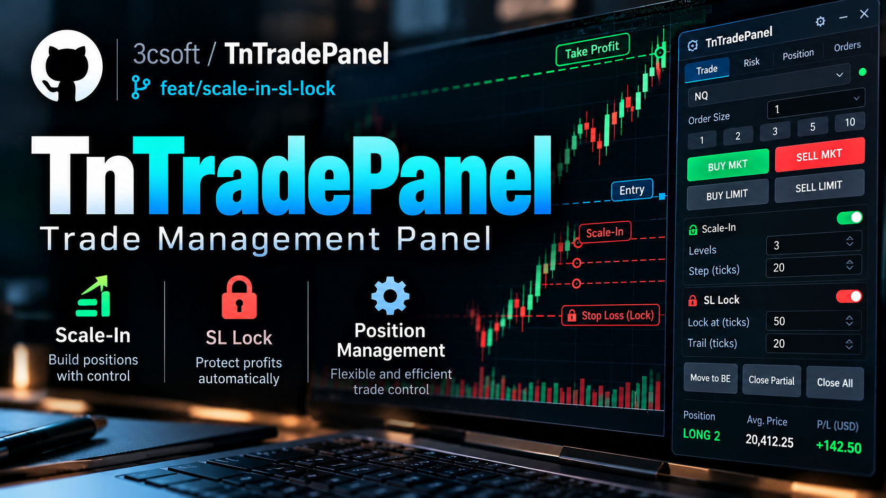

# TN Trade Panel

> **⚠ EXPERIMENTAL — USE AT YOUR OWN RISK**
>
> This is a **strictly experimental** system. It has been tested **only** on **Rithmic futures**, specifically **MNQ**. Behavior on other brokers, data feeds, or symbols is unknown and unsupported.
>
> **We accept no liability** for trading losses, missed stops, software bugs, freezes, or any other damage arising from use of this software. The virtual SL is **not** a broker-side stop — if Quantower, the plugin, or the indicator stops updating, protection may fail. **Paper-trade first.** You alone are responsible for every order you send.

A dockable **risk-sized trade panel** for [Quantower](https://www.quantower.com), with draggable chart lines and a **virtual stop-loss** (no SL order — price touch flattens the account).

You place Entry / SL / TP lines on the chart. The panel sizes the order from a **USD risk amount** or a **fixed contract count**, then **Enter** sends it with TP attached. The SL stays as a managed line. Optional tools after entry: break-even, partial exits, a scalping trail, and an MA exit that flattens the account when price touches a chart SMA or EMA.

### Short demo

[](https://youtu.be/sMG_ZUogGO0)

Watch on YouTube: [https://youtu.be/sMG_ZUogGO0](https://youtu.be/sMG_ZUogGO0)

## Features

- **Risk amount / Fix contracts** — switch on the panel. Risk amount sizes quantity from a USD risk and is also the **emergency flatten** if floating loss reaches that amount (even while dragging SL). Fix contracts sends that many contracts; the panel shows the resulting USD risk. The active value is edited on the panel. Settings only store the defaults.
- **Min 1 contract (optional, off by default)** — if risk-amount sizing gives quantity 0, enter with the minimum lot and temporarily raise the risk-amount limit to that trade's risk until flat. Fix-contracts mode does not use this fallback.
- **Daily max loss (USD, 0 = off)** — once the day's PnL (broker Net PnL + live open PnL) reaches −limit, entries are blocked and the account is flattened.
- **Max open contracts** — default 10; entries/scale-ins are capped so total open size on the linked symbol cannot exceed this (partial fill of the sized quantity when headroom is smaller).
- **Lines** — place or clear Entry, SL, TP on the color-linked chart (indicator required). Each line has a wide colored tag with a round grip on the left for easy dragging.
- **LONG / SHORT** — draw direction; opposite side blocked while a position is open.
- **Entry on/off** — toggle Entry while SL/TP are already out; always snaps to current market.
- **Enter** — market / limit / stop entry with TP; SL remains a **virtual line** (no protective SL order).
- **Virtual SL** — when price touches the SL line, **all positions and orders** on the selected account are flattened.
- **SL risk lock** — after entry, SL cannot widen beyond the stop captured at that entry (snaps back on drop). A scale-in overwrites the baseline with wherever the SL stands at the new entry.
- **BE line** — purple button; with an open position, drag into place; on touch, SL moves to avg entry ± offset ticks and the BE line is removed.
- **Scalping** — panel toggle, off by default. In profit, when the current with-trend candle breaks the last counter-candle group (long: the reds' highest high; short: the greens' lowest low), the SL jumps past that group's other extreme by the offset in Settings. The same tick offset is used when a BE line is hit.
- **Partial close & trade management** (Settings, off by default) — after entry, optional auto BE and two partial exits measured as % of the Entry↔SL distance. Partial size uses ceil (1 contract × 50% closes 1) and is sent as a reducing market order, so a 4-lot position at 75% closes 3 and leaves 1. The second partial waits until that fill reduces the open quantity. Remainder is left for manual exit.
- **Scale-in** — only allowed when SL is already at/beyond prior entry (no open risk).
- **Panic** — close everything on the account and reset line state.
- **MA exit** — button under Scalping. While on, a fresh touch of the chart-timeframe SMA or EMA (type and period in Settings) flattens the account the same way as Panic, in profit or in loss. Turning it on does not exit if price is already on the average; the next touch does. Stays armed for the next trade.
- **Lock 1h** — confirm once; blocks panel entries for the selected account (that connection) for one hour. Survives Quantower restart; clears when the hour is up.
- **Lock Out** — confirm once; blocks panel entries for the selected account (that connection) for the rest of the local day. Survives Quantower restart; clears tomorrow.
- **Ghost-order warning** — flashing alert under Panic when the account has no position but leftover working orders.
- **Account panel** — bottom toggle shows Balance, Cash on hand, and Daily PnL.
- **Line style** — colors, width, dash style in Settings.

Built-in chart Order Entry is not modified.

## Requirements

- Quantower **v1.146+** (built against v1.146.17)
- Linked chart **symbol** and a selected **account**
- Indicator **TN Trade Panel Lines** on the same (or color-linked) chart
- .NET 10 SDK only if you build from source

## Install

Quantower loads custom scripts from the **user Settings** tree (not Program Files). Typical Windows paths:

| Component | Destination |
| --- | --- |
| Plugin | `C:\Quantower\Settings\Scripts\plug-ins\TNTradePanel\` |
| Indicator | `C:\Quantower\Settings\Scripts\Indicators\TNTradePanelLines\` |

Create the folders if they do not exist. After copying, **restart Quantower**, then:

1. Open the panel: **Panels → TN Trade Panel**
2. Add the indicator on the chart: **Indicators → Custom → TN Trade Panel Lines**
3. Color-link the panel to the chart and pick an account

### Option A: pre-built files from `dist/` (no compilation)

This repository ships a **Release** build under [`dist/`](dist/). Layout mirrors Quantower’s folders:

```
dist/
  plug-ins/TNTradePanel/          → copy into ...\Settings\Scripts\plug-ins\TNTradePanel\
  Indicators/TNTradePanelLines/   → copy into ...\Settings\Scripts\Indicators\TNTradePanelLines\
```

Copy **everything** from each subfolder (`.dll`, `.deps.json`, and for the plugin the `HTML\` folder) **except** `dist/README.txt`.

PowerShell (from the cloned repo root):

```powershell
$scripts = "C:\Quantower\Settings\Scripts"
$plugin  = Join-Path $scripts "plug-ins\TNTradePanel"
$ind     = Join-Path $scripts "Indicators\TNTradePanelLines"

New-Item -ItemType Directory -Force -Path $plugin, $ind | Out-Null
Copy-Item -Path ".\dist\plug-ins\TNTradePanel\*" -Destination $plugin -Recurse -Force
Copy-Item -Path ".\dist\Indicators\TNTradePanelLines\*" -Destination $ind -Recurse -Force
```

If your Quantower profile lives elsewhere, change `$scripts`.

### Option B: build from source

```powershell
git clone https://github.com/3csoft/TnTradePanel.git
cd TnTradePanel
dotnet build TNTradePanel.slnx -c Release
```

Release builds write into your Quantower Scripts folders (see defaults below) **and** refresh `dist/`.

#### Maintainer: refresh `dist/` before pushing

```powershell
dotnet build TNTradePanel.slnx -c Release
git add dist/
git status
git commit -m "chore: refresh dist binaries for release"
```

#### Environment / defaults

| Property | Default | Purpose |
| --- | --- | --- |
| `QuantowerRoot` | `C:\Quantower` | Quantower install root |
| `QuantowerVersion` | `v1.146.17` | Platform folder under `TradingPlatform\` |
| `QuantowerBin` | `...\TradingPlatform\v1.146.17\bin` | Reference assemblies |
| `QuantowerScripts` | `...\Settings\Scripts` | Plugin / indicator output |

Override via MSBuild properties or by editing [`Directory.Build.props`](Directory.Build.props).

## How it works

```
Plugin  (TNTradePanel)
   ↕  TradeSetupHub  (shared state via AppDomain.SetData)
Indicator  (TNTradePanelLines)  ← must be on the chart for draw/drag
         ↓
   Core.Instance.PlaceOrder  (entry + TP; no SL order)
```

1. Press **LONG** or **SHORT**, then **Lines** to place levels; drag SL/TP/Entry on the chart.
2. Panel shows **Quantity** and **RR** from the selected size mode (risk amount or fixed contracts) and the distances.
3. **Enter** sends the order. Entry/TP chart lines clear (they became real orders); SL stays locked.
4. Price touching the SL line → full account flatten + state reset.
5. **BE line** (optional) → on touch, SL jumps to average entry + offset ticks (Settings).
6. **Trade management** (optional, Settings) → after entry, auto BE and up to two partial exits, each a percent of the Entry↔SL distance. A partial is a reducing market order (4 contracts × 75% sells 3 and leaves 1). The second partial waits until the first fill shows up.
7. **Scalping** (optional) → trails the virtual SL behind broken counter-candle groups while the trade is in profit.
8. **MA kiszállás** (optional) → while the button is on, the next time the current chart candle touches the SMA or EMA from Settings, the account is flattened like Panic. Profit and loss both count. The average uses the chart timeframe. Turning the button on while price is already on the average does not exit; the next fresh touch does. The button stays on for the following trade.
9. **Fix contracts** that risk more than the risk amount raise the emergency flatten limit to that trade's risk until the account is flat, so the virtual SL is not cut off early.

## Panel controls

| Control | Action |
| --- | --- |
| **Account** | Select trading account (or Account lookup) |
| **Risk amount / Fix contracts** | Size mode. The input under the buttons edits the active value (USD risk, or contract count) |
| **Entry: on/off** | Show/hide Entry line; with SL/TP out, places at current market |
| **LONG / SHORT** | Draw direction |
| **Lines** | Toggle Entry/SL/TP placement (yellow button) |
| **BE line** | Toggle break-even line (open position only); removed when hit |
| **Scalping** | Toggle the candle-trail stop (in profit only) |
| **MA kiszállás** | Toggle MA exit. On a fresh touch of the chart SMA/EMA, flatten the account like Panic |
| **Enter** | Place order |
| **Panic** | Flatten account + clear setup |
| **Ghost warning** | Flashes under Panic if orders remain with no open position |
| **Account [show]** | Expand/collapse Balance, Cash on hand, Daily PnL |

## Settings

- **Default size mode** — Risk amount or Fix contracts
- **Default risk amount (USD)** — starting risk amount; also the emergency flatten limit
- **Default fixed contracts** — starting contract count for Fix contracts mode
- **BE hit: SL = avg entry + X ticks** — also the scalping SL offset past the counter-candle extreme
- **Allow 1 contract when quantity = 0** (default off)
- **Daily max loss (USD, 0 = off)**
- **Max open contracts** (default 10)
- **MA exit type** — SMA or EMA, on the chart timeframe (default SMA)
- **MA exit period** (default 20)
- **Partial close & trade management** (master toggle)
  - **BE after (% of Entry↔SL, 0 = off)** — default 100
  - **1st / 2nd exit level (% of Entry↔SL, 0 = off)** — defaults 100 / 200
  - **1st / 2nd partial close (% of open qty, ceil)** — default 50 / 50
- Entry / SL / TP / BE **line colors**, **width**, **style** (Solid, Dash, Dot, …)

## Troubleshooting

- **No lines / BE / scalping / MA exit does nothing** — add **TN Trade Panel Lines** to the chart and restart Quantower after a DLL update. MA exit uses that chart's timeframe. The status bar warns if the indicator is missing.
- **MA exit did not close while price was already on the average** — arming waits for the next touch, so a candle that is sitting on the MA does not flatten until price leaves and comes back.
- **Wrong symbol / continuous vs dated** — panel and indicator match continuous roots (e.g. `MNQ`) to dated contracts (`MNQZ6.CME`).
- **SL widens again** — restart Quantower after updating DLLs so both plugin and indicator load the same build.
- **Quantity: 0** — raise the risk amount, tighten SL, switch to Fix contracts, or enable *Allow 1 contract when quantity = 0*.
- **Daily limit shows "—"** — the broker does not publish a `Net PnL` account field; the daily limit is then inactive.

## Disclaimer

**Strictly experimental.** Tested only on **Rithmic futures (MNQ)**. Not financial advice. Trading involves substantial risk of loss. The authors and publishers **accept no responsibility** for any losses or damages. Virtual SL management depends on the panel/indicator running and receiving ticks — it is **not** a broker-side stop. **Test on a simulator before using on a live account.**

## License

Released under the [MIT License](LICENSE).
